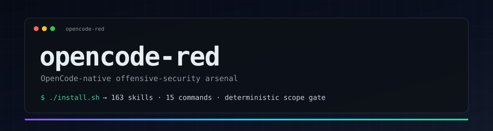
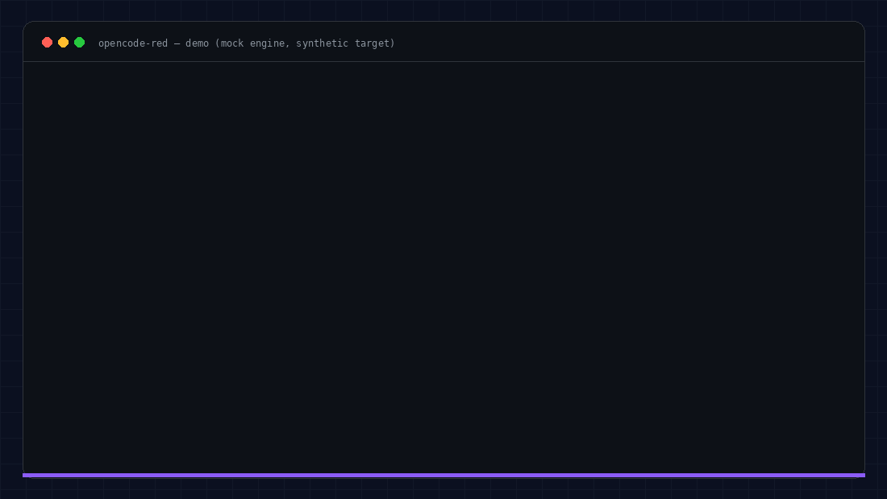
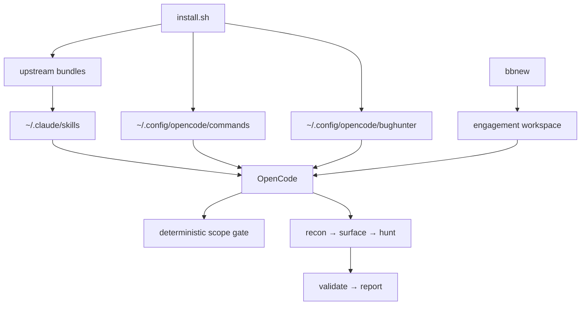

<p align="center">
  
</p>

# opencode-red

**An OpenCode-native offensive-security arsenal.** 163 curated skills, 15 slash
commands, a deterministic scope gate, engagement scaffolding, and a reproducible
toolchain bootstrap — installed in one command.

[](https://github.com/danielvaldess/opencode-red/actions/workflows/ci.yml)
[](LICENSE)
[](https://opencode.ai)
[](docs/ARSENAL.md)

```bash
git clone https://github.com/danielvaldess/opencode-red.git
cd opencode-red && ./install.sh
```

<p align="center">
  
</p>
<p align="center"><sub>Scope check → URL classification → mock engine run. Synthetic target, no network. Run it with <code>examples/demo.sh</code>.</sub></p>

---

## Why this exists

The best public offensive-security skill libraries were written for Claude Code.
They are excellent, but OpenCode is not Claude Code:

- OpenCode discovers skills by **directory name**, not frontmatter `name`.
- It only advertises skills that have a **description**, and one of the upstream
  bundles ships 28 skills without YAML frontmatter.
- Its commands live in `~/.config/opencode/commands/`, not `~/.claude/commands/`.
- It reads `AGENTS.md`, not `CLAUDE.md`.
- The bundle's engine dispatches `claude -p`, which does nothing if Claude Code is
  not installed.

`opencode-red` fixes those gaps, pins the whole thing behind an idempotent
installer, and adds what a real engagement needs: a **deterministic scope gate**,
per-program workspaces, evidence hygiene, and a catalogue you can learn from.

## What you get

| Layer | Contents |
|---|---|
| **Skills** | 84 bug-bounty core + 79 red-team skills, installed into `~/.claude/skills` (OpenCode compatibility path) |
| **Commands** | 15 adapted commands: `/hunt`, `/bb-recon`, `/scope`, `/triage`, `/validate`, `/report`, `/chain`, `/intel`, `/surface`, `/pickup`, `/remember`, `/memory-gc`, `/autopilot`, `/token-scan`, `/web3-audit` |
| **Engine** | Deterministic scope checker, recon/ranking, engagement memory and a `cbh` CLI |
| **Workspace** | `bbnew <program>` scaffolds `scope.md`, `AGENTS.md`, findings, evidence and a submissions tracker |
| **Toolchain** | Optional bootstrap for subfinder, httpx, katana, gau, dalfox, nuclei, semgrep, trufflehog, gitleaks and friends |
| **Docs** | Full generated skill catalogue, workflow, tooling, program selection and troubleshooting |

## Quick start

**Requirements:** OpenCode 2.x, Python 3.9+, Git. Linux, macOS or WSL.
Optional: Go and `pipx` for the external tools.

```bash
git clone https://github.com/danielvaldess/opencode-red.git
cd opencode-red

./install.sh              # skills + commands + engine + workspace
./install.sh --tools      # also install the external toolchain
./scripts/verify.sh       # health check
```

Create your first engagement:

```bash
bbnew acme
cd ~/bounties/acme
# fill scope.md from the program page
```

If `bbnew` is not found, add `~/.local/bin` to `PATH`.

Open OpenCode in that directory and run:

```
/bb-recon acme.com
/surface acme.com
/hunt acme.com
```

Before any active request:

```
/scope api.acme.com
```

## How it works



**Design principles**

1. **Deterministic before generative.** Scope, recon breadth and memory are plain
   code; the model is reserved for judgment calls.
2. **Deny-wins by default.** An empty scope file denies everything. Out-of-scope
   beats in-scope when both match.
3. **Reproducible.** The installer is idempotent and backs up what it replaces.
   Upstream text is never edited beyond the documented compatibility patches.
4. **Attribution-first.** Upstream bundles keep their MIT licenses and are credited
   in `NOTICE.md`.

## The arsenal

The full, generated catalogue is **[docs/ARSENAL.md](docs/ARSENAL.md)**.

| Core group | Skills |
|---|---:|
| Core methodology & tradecraft | 6 |
| Recon & OSINT | 7 |
| Web, API & application classes | 47 |
| Validation & reporting | 4 |
| Enterprise platforms & identity | 8 |
| Cloud, containers & CI/CD | 4 |
| Mobile applications | 2 |
| AI / LLM security | 2 |
| Web3 & fintech | 3 |
| Source-code audit | 1 |

The red-team layer adds 79 skills across web, auth, API, cloud, Active Directory,
infrastructure, privilege escalation, post-exploitation, network, wireless, IoT,
mobile, CI/CD, supply chain, AI, crypto, forensics, fuzzing, exploit development,
containers and social engineering.

Load one explicitly with `@hunt-idor`, `@offensive-cloud`, `@security-audit`, etc.
Skills with no description are not advertised; the installer fixes that.

## Scope safety

Every engagement gets a `scope.md`. The checker is code, not model judgment:

```bash
python3 "$HOME/.config/opencode/bughunter/engine/scope.py" api.acme.com --md ./scope.md
# IN-SCOPE   api.acme.com
```

| Pattern | Matches |
|---|---|
| `acme.com` | apex **and any subdomain** |
| `*.acme.com` | subdomains, **not** the apex |
| `10.0.0.0/8` | any IP in the CIDR |
| `re:^lab[0-9]+\.acme\.io$` | explicit regex |

Deny wins. An empty in-scope list denies everything. `/scope` runs this checker
before any active phase and stops on `OUT-OF-SCOPE`.

## Toolchain

`./install.sh --tools` bootstraps, into `~/go/bin` and `~/.local/bin`:

| Area | Tools |
|---|---|
| Recon | `subfinder`, `dnsx`, `httpx` (ProjectDiscovery), `katana`, `gau`, `waybackurls`, `assetfinder`, `chaos` |
| Content | `ffuf`, `feroxbuster`, `gobuster`, `nuclei` |
| Web | `dalfox`, `sqlmap`, `ghauri`, `jwt_tool` |
| Code | `semgrep`, `trufflehog`, `gitleaks` |
| Mobile | `jadx`, `apktool` |
| Helpers | `anew`, `gf` + patterns, `SecretFinder` |

The script never installs system packages and skips what is already present.
See [docs/TOOLS.md](docs/TOOLS.md) for manual installs and wordlists.

## Updating

```bash
cd opencode-red
git pull
./install.sh                  # fetches the latest upstream bundles
python3 scripts/generate_arsenal.py   # refresh the catalogue
```

The installer fetches the three upstream repositories into
`~/.local/share/opencode-red/upstream` and re-applies the OpenCode compatibility
patches. Everything it replaces is backed up under
`~/.local/share/opencode-red/backups/`.

## Repository map

```
opencode-red/
├── install.sh                 # one-command installer
├── scripts/
│   ├── install_skills.py      # skills, commands, engine, cbh
│   ├── install_tools.sh       # optional external toolchain
│   ├── new-engagement.sh      # bbnew scaffolder
│   ├── generate_arsenal.py    # docs/ARSENAL.md generator
│   └── verify.sh              # environment health check
├── commands/                  # 15 OpenCode slash commands
├── config/agent.opencode.py   # engine dispatch overlay (opencode run)
├── templates/                 # workspace, finding and report templates
├── examples/                  # synthetic scope, engagement and demo script
├── docs/                      # arsenal, cheat sheet, workflow, tools, programs
├── assets/                    # banner and demo
└── licenses/                  # upstream MIT licenses
```

## Documentation

- [Arsenal catalogue](docs/ARSENAL.md)
- [Cheat sheet](docs/CHEATSHEET.md)
- [Workflow](docs/WORKFLOW.md)
- [OpenCode compatibility notes](docs/OPENCODE.md)
- [Toolchain](docs/TOOLS.md)
- [Choosing a program](docs/PROGRAMS.md)
- [Troubleshooting](docs/TROUBLESHOOTING.md)
- [Architecture](docs/ARCHITECTURE.md)

## Legal

This repository contains **knowledge and tooling**, not permission. Use it only
against systems you own or are explicitly authorized to test, and only within the
scope and rules of the relevant program or engagement. You are responsible for
your actions. See [SECURITY.md](SECURITY.md).

## Credits

Built on the work of:

- **[Claude-BugHunter](https://github.com/elementalsouls/Claude-BugHunter)** — Sachin Sharma (MIT)
- **[claude-red](https://github.com/SnailSploit/claude-red)** — SnailSploit (MIT)
- **[security-review](https://github.com/cdmx-in/security-review)** — Codemax IT Solutions (MIT)

The installer, command adaptations, engine overlay, scaffolding, templates and
documentation in this repository are MIT-licensed. See [NOTICE.md](NOTICE.md).

*Not affiliated with the OpenCode project or with the upstream skill authors.*

## Contributing

Issues and pull requests are welcome. Please read [CONTRIBUTING.md](CONTRIBUTING.md)
and run `./scripts/verify.sh` before opening a PR.

## License

[MIT](LICENSE) © 2026 Daniel Valdés
