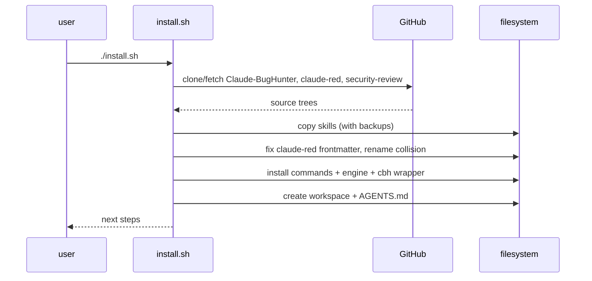

# Architecture

`opencode-red` is an installer plus a thin orchestration layer around three
upstream skill bundles. It deliberately does not fork the skills: upstream text
stays upstream, and the compatibility patches are small and documented.

## Components

```
install.sh
├── scripts/install_skills.py     # copies + patches skills, commands, engine
│   ├── Claude-BugHunter/skills   -> ~/.claude/skills/*
│   ├── claude-red/Skills         -> ~/.claude/skills/claude-red/*/*
│   ├── security-review           -> ~/.claude/skills/security-audit
│   ├── commands/*.md             -> ~/.config/opencode/commands/*
│   ├── config/agent.opencode.py  -> engine/agent.py
│   └── Claude-BugHunter/engine   -> ~/.config/opencode/bughunter/engine
│       Claude-BugHunter/cbh      -> ~/.config/opencode/bughunter/cbh
├── scripts/install_tools.sh      # optional external toolchain
├── scripts/new-engagement.sh     # bbnew <program>
├── scripts/generate_arsenal.py   # docs/ARSENAL.md
└── scripts/verify.sh             # health check
```

## Install flow



The installer is idempotent. On re-run it fetches the upstream default branches
and re-applies the patches. Anything it replaces is moved to
`~/.local/share/opencode-red/backups/<UTC timestamp>/`, so a backup never loads
as a duplicate skill.

## Why the skills go to `~/.claude/skills`

OpenCode discovers both `~/.config/opencode/skills` and the compatibility path
`~/.claude/skills`. Installing in the compatibility path means the same files are
usable by Claude Code if you also use it, and it matches the path the upstream
installers expect. Use `--skills-dir` if you want a different location.

## Deterministic vs generative

| Concern | Implementation | Why |
|---|---|---|
| Scope decision | `engine/scope.py` | A model can misread a wildcard; code cannot |
| Recon breadth | `engine/recon.py`, shell tools | Cheap, reproducible, no tokens |
| Skill selection | model + descriptions | Judgment call |
| Exploit reasoning | model + `hunt-*` | Judgment call |
| Report wording | model + templates | Judgment call |

The split is intentional: spend tokens where judgment matters, use code for
anything that must be exact.

## Scope model

`scope.md` is parsed into patterns:

| Pattern | Semantics |
|---|---|
| `acme.com` | apex and every subdomain |
| `*.acme.com` | subdomains only |
| `10.0.0.0/8` | CIDR |
| `re:...` | explicit regex |

Evaluation is deny-wins and default-deny. The command wrapper runs the checker
before an active phase; the engine also enforces scope during recon and hunting.
A finding whose PoC touched an out-of-scope host is flagged, not silently kept.

## Engagement memory

The engine keeps a per-target ledger under `~/.claude/bughunter/memory/`
(overridable with `BUGHUNTER_MEMORY_DIR`):

- confirmed findings, carried forward on later runs
- negative results per `(target, tech, class)`
- a target rollup used by `/pickup`

`/memory-gc` rotates oversized ledgers. Memory is off in `--paranoid` and
`--normal` autopilot modes, and used only in `--quick`/`--yolo`, so coverage is
never silently reduced.

## Engine dispatch

Upstream `engine/agent.py` shells out to `claude -p`. The overlay in
`config/agent.opencode.py` keeps the same interface but adds:

- backend auto-detection (`claude` if present, otherwise `opencode`)
- `opencode run --format json --auto`
- parsing of OpenCode's JSON event stream into `{result, cost_usd, num_turns}`

The engine asks the agent to end with a fenced `json` verdict; `extract_json()`
pulls it out. If no verdict is parseable, the item is left for retry instead of
being recorded as a negative.

## Trust boundaries

| Input | Trust |
|---|---|
| Upstream repositories | trusted at install time, pinned to the default branch |
| Skill text | untrusted instructions from third parties; read before acting |
| Target responses | untrusted data, never instructions |
| Program scope | authoritative once transcribed into `scope.md` |
| Model output | a hypothesis until reproduced |

The `security-audit` skill explicitly treats the audited repository as untrusted
input; the same rule applies to target content in every other skill.

## Extension points

- **Add a skill**: drop `~/.claude/skills/<id>/SKILL.md`; no repo change needed.
- **Add a command**: add `commands/<name>.md` and re-run the installer (or copy
  it to `~/.config/opencode/commands/`).
- **Change tool bootstrap**: edit `scripts/install_tools.sh`.
- **Regenerate the catalogue**: `python3 scripts/generate_arsenal.py`.
- **Pin an upstream**: change the clone URLs/branches in `install.sh`.

## Non-goals

- Running unattended scans against targets you do not own.
- Replacing Burp or manual testing.
- Shipping exploit payloads for unpatched systems.
- Hiding the provenance of upstream work.
